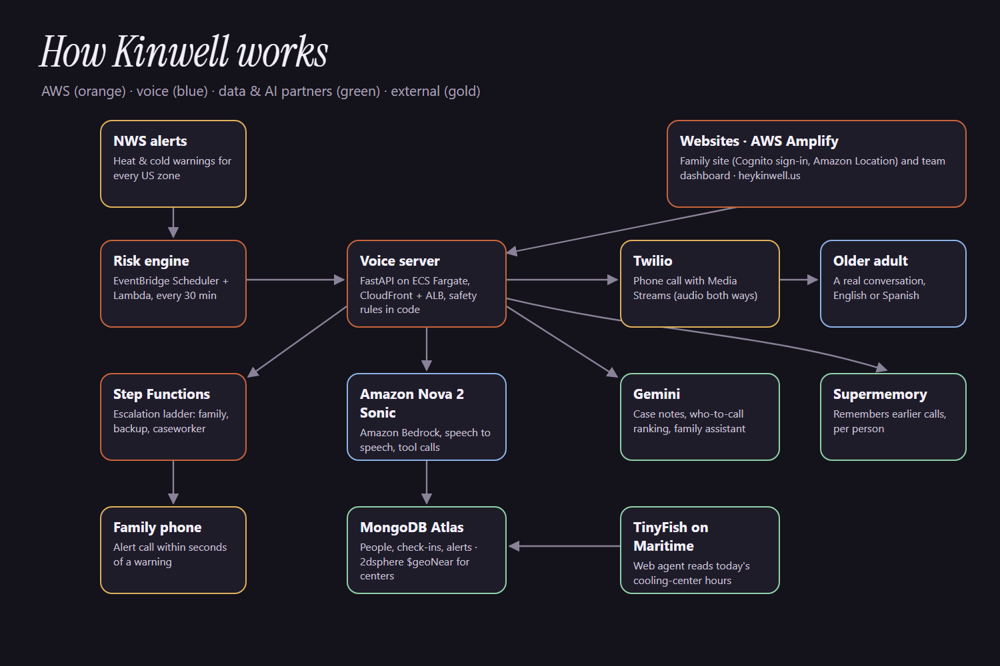

# Kinwell

**Kinwell phones older adults on dangerous heat and cold days, has a real conversation in their language, and alerts their family within seconds when something is wrong.**

Built at sunhacks 9.0 (Nov 14 to 15, 2026).

- **Family site:** https://heykinwell.us
- **Team dashboard:** https://team.heykinwell.us
- **Demo video and write-up:** on our Devpost page



## Why

Maricopa County confirmed 645 heat deaths in 2023 and 608 in 2024, and many people died alone at home. Cold snaps do the same across the country through hypothermia and carbon monoxide from unsafe heating. During a record heat wave, county staff phoned 93 vulnerable clients a week by hand. Kinwell makes that check-in call to thousands of people on the same afternoon, and only pulls in a human when someone needs one.

Texts and apps don't reach someone who is 82, confused by heat, and not looking at a phone. A phone call does.

## What it does

1. **A son or daughter adds a parent** on the Family site (Amazon Cognito sign-in). A Gemini assistant asks one thing at a time, by text or voice: name, number, address, language, backup contact. The server validates every answer and the assistant is hardened against prompt injection.
2. **Permission first.** Kinwell calls the parent, explains who signed them up, and asks if it may call on dangerous days. Nothing starts until they say yes.
3. **Weather-triggered calls.** Every 30 minutes a risk engine checks National Weather Service alerts for the zones of everyone enrolled, anywhere in the US. On an Extreme Heat, Heat Advisory, Extreme Cold, Cold Weather or Wind Chill warning, Kinwell calls.
4. **A real check-in, in English or Spanish**, on Amazon Nova 2 Sonic (speech to speech, real time):
   - Heat: Is the AC working? How hot is it inside? Water today? Dizziness, headache, nausea, confusion?
   - Cold: Is the heat working? How warm is it inside? Power and gas? Any oven, stove, grill or generator used indoors for heat? Shivering, numbness, sleepiness?
5. **It acts on what it hears.**
   - Emergency signs: it says "call 9 1 1 now" and alerts every contact at once.
   - Warning signs: it offers the nearest cooling or warming center, knows whether it is open right now, offers a ride, books a callback, and phones the family within seconds.
6. **Escalation ladder.** If the first contact doesn't answer, Step Functions moves to the backup, then the caseworker.
7. **Memory.** Supermemory lets the next call open with "Last time your AC was broken. Is it fixed?"
8. **Team dashboard.** Caseworkers see who needs a human, what Kinwell is already handling, and who is safe. Gemini ranks who to call first. Every call has a case note, the answers, who has been told, and the transcript. On a phone it becomes an on-call view.

Two playbooks run on one engine:

| | Residents | Crew Check (outdoor workers) |
|---|---|---|
| Who | Older adults, people living alone, homes at risk of AC or heat failure | Roofing and construction crews |
| Questions | Heat or cold questions above | Water in the last hour? Shade or rest break? Symptoms? Coworker unwell? |
| Escalation | Family, backup, caseworker | Supervisor, then backup |
| Privacy | Family sees alerts for their person | Supervisor sees answers only when a red flag or missed check-in fires |

## Architecture

```
NWS alerts ─▶ EventBridge Scheduler ─▶ Lambda risk engine ─┐
Dashboard "Simulate heat / cold" ──────────────────────────┤
                                                           ▼
Phone ◀─ Twilio Voice ─wss─▶ CloudFront ─▶ ALB ─▶ ECS Fargate voice server ─▶ Amazon Nova 2 Sonic (Bedrock)
                                                │   tools: record_checkin, flag_risk, find_cooling_center,
                                                │   find_warming_center, schedule_callback, end_call, ...
                                                ├─▶ MongoDB Atlas (people, check-ins, alerts, resources; $geoNear, TTL)
                                                ├─▶ Supermemory (one memory space per person)
                                                ├─▶ Gemini (case notes, ranked briefing, family assistant)
                                                └─▶ Step Functions escalation ladder ─▶ alert calls, follow-up calls

Resource Scout (TinyFish web agent) ─▶ Atlas (today's cooling and warming center hours)
Family site + team dashboard on AWS Amplify (heykinwell.us) ◀── live state from the voice service
```

| Component | Built with |
|---|---|
| Voice agent | Amazon Nova 2 Sonic (`amazon.nova-2-sonic-v1:0`), bidirectional stream, 8 kHz phone audio both ways |
| Phone bridge | Twilio Programmable Voice with Media Streams; asynchronous answering-machine detection |
| Voice service | Python (FastAPI) on ECS Fargate behind ALB and CloudFront (HTTPS/WSS) |
| Escalation | AWS Step Functions (wait-for-callback task token), Lambda |
| Risk engine | EventBridge Scheduler and Lambda polling the NWS alerts API for every enrolled zone |
| Database | MongoDB Atlas: 2dsphere index and `$geoNear` for the nearest open center; TTL index expires transcripts |
| Memory | Supermemory API v5, one namespace per person |
| Web agent | TinyFish Agent API reads library and cooling-center pages for today's hours |
| Text AI | Gemini: structured case notes, the ranked briefing, and the family enrollment assistant |
| Family sign-in | Amazon Cognito user pool; ID tokens verified on the server |
| Geocoding | Amazon Location Service (US Census geocoder as fallback), cached in Atlas |
| Websites | React, Vite, TypeScript, Tailwind, MapLibre, AWS Amplify Hosting; the Family site is an installable PWA |
| Domain | heykinwell.us |

## Safety and privacy design

- **Rules decide emergencies, not the model.** Sonic reports facts through tools; `voice/rules.py` decides who gets alerted, so outcomes are predictable and auditable. A home at 90°F or hotter is a warning even when the AC is "working."
- **Guards in code, not just in the prompt.** The server refuses to hang up before the key answers are recorded, insists on offering the nearest center when there are warning signs, and hangs up for the agent if it says goodbye but forgets to end the call. A daily call cap per person stops runaway calling.
- **Unconfirmed is never "safe."** Voicemail, a dropped call, or a call that ends before answers goes to the no-answer path: retry, then the escalation ladder.
- **Consent first.** Nobody is checked on until they say yes on a permission call, and the agent says it is automated in its first sentence.
- **Data minimization.** No call audio is stored; transcripts expire after 30 days through a TTL index; memory holds short safety summaries only.
- **Live data honesty.** The agent quotes only centers and hours from Resource Scout records, and says when a place is closed right now.
- **Screening, not diagnosis.** Questions follow common heat-illness, cold-exposure and carbon monoxide warning signs; emergency signs always produce "call 9 1 1 now."

## Making calls feel human

- The Nova Sonic session is opened, primed and generates the greeting **while the phone is still ringing**, so the first words play as soon as the call connects (held about 1.5 seconds so the person has the phone at their ear).
- Answering-machine detection runs asynchronously, so a person who answers never waits in silence while Twilio listens for a voicemail.
- The opening is one intro sentence plus the first question; tool use is silent; there is one closing line.

## Repository layout

```
voice/       voice service: Twilio bridge, Nova Sonic session, tools, rules, weather, family API, memory, notes
family/      Family site (React PWA): sign-in, assistant, consent status, check-now
dashboard/   team dashboard (React): lanes, call detail, map, crews, resources, on-call phone view
scout/       Resource Scout: TinyFish agent, plus an HTTP wrapper and Dockerfile packaging it as a Maritime agent
infra/       CloudFormation: voice.yaml (Fargate, ALB, CloudFront), escalation.yaml (Step Functions, Lambda, Scheduler), family.yaml (Cognito)
scripts/     seeding, demo data, simulated caller, deploy scripts
demo/        demo video tooling: scripted screen recordings, Nova Sonic narration, automated edit, gallery images
```

## Running it

Requirements: Python 3.13, Node 22+, Docker, an AWS account with Bedrock access to Nova 2 Sonic in us-west-2, plus Twilio, MongoDB Atlas, Gemini, Supermemory and TinyFish keys.

```bash
cp .env.example .env                          # fill in keys
python -m venv .venv && .venv/Scripts/pip install -r voice/requirements.txt
python scripts/seed_atlas.py                  # indexes and demo people
python -m scout.resource_scout                # live cooling-center hours
python scripts/sim_call.py en_warning         # full simulated call, no phone needed
bash scripts/deploy_voice.sh                  # Fargate (after infra/voice.yaml is deployed once)
python scripts/deploy_dashboard.py https://<voice-cloudfront-domain> dashboard
python scripts/deploy_dashboard.py https://<voice-cloudfront-domain> family
```

`scripts/sim_call.py` runs a complete check-in without a phone: Gemini plays the caller from a persona, Amazon Polly speaks the replies as 8 kHz audio into the same Nova Sonic session, and contact alerts run in dry-run mode. Scenarios: `en_warning`, `en_followup`, `en_clear`, `es_warning`, `crew_ok`.

The dashboard includes a clearly labeled synthetic demo population (`scripts/demo_population.py`, records flagged `demo`, no phone numbers). Remove it with `--remove`.

## Limits and honest notes

- Nova Sonic allows 20 concurrent sessions per region; calls are queued by risk and can spread across regions.
- Resource Scout is packaged as a Maritime agent (`scout/server.py`, `scripts/maritime_deploy.py`) but was not deployed to Maritime for the demo; it ran on demand.
- Cooling-center data in November comes from public library hours (Phoenix and Tempe) plus a seeded Flagstaff warming center. More sources, such as the county Heat Relief Network in summer, are added in `scout/sources.json`.
- Alerts to contacts go by voice call; US text messages need a registered sender.
- A typical 3-minute check-in costs about $0.10 (Twilio plus Nova Sonic).
